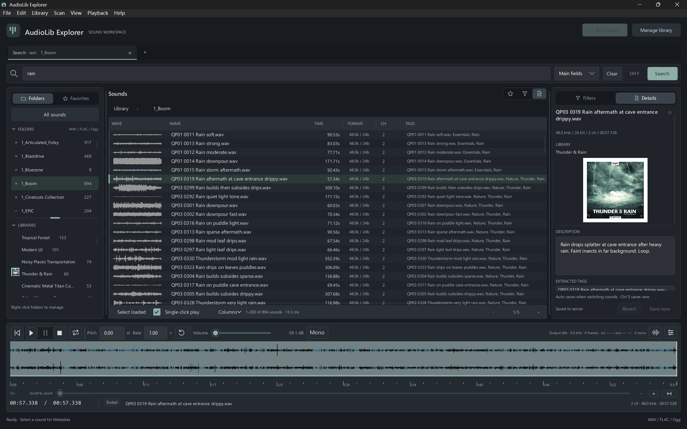

# AudioLib Explorer — Maomao Edition

Maintained by [Maomao (pangqichenmmm)](https://github.com/pangqichenmmm), based on [upstream AudioLib Explorer v0.8.7](https://github.com/Freedragonlancer/AudioLib-Explorer/releases/tag/v0.8.7). The Windows client uses a vivid, REAPER-reference Spectral Peaks palette in both the settings legend and the Waveform. The underlying frequency analysis is preserved; the colors are a visual calibration, not a reproduction of REAPER's internal algorithm.

由 Maomao 维护的个人分支，基于官方 0.8.7，保留 REAPER 参考频谱峰值配色。通过 `Start-AudioLibExplorer.cmd` 启动；脚本关闭官方更新检查，后续升级从本分支重新合并和构建。每台电脑的配置、凭据和缓存仍保存在本机。


**AudioLib Explorer 帮助声音设计师建立属于自己的音效库。**

开源免费的音效库管理软件（SFX 音效浏览、检索、试听、元数据管理），面向声音设计、游戏音频和影视拟音（Foley），可作为 Soundminer 的开源替代方案。

- 三种部署方式：纯客户端单机、客户端加局域网服务端、客户端加公网域名服务端。
- 公网音频流支持缓存和按需读取，减少试听等待。
- 服务端数据库同步到本地快照，搜索直接在客户端执行。
- 支持「主字段」「全部」「仅路径」「仅文件名」四种搜索范围，可与目录和筛选条件组合；路径范围需要准备目录索引。
- 扫描与试听 WAV/BWF、MP3、AIFF、FLAC、Ogg Vorbis 和 OGA/Ogg FLAC；提取内嵌 Metadata。Opus 仅支持标签探测，不支持播放。
- 本地和服务器模式支持厂商 CSV/TSV/TXT/XLS/XLSX Metadata 导入：先预览和确认匹配，再提交，可回滚导入。
- 可承载 10 TB 以上的大规模音效素材库。

**AudioLib Explorer helps sound designers build a sound-effects library of their own.**

A free, open-source sound effects (SFX) library manager for sound design, game audio and Foley: browse, search, preview and tag audio files. An open-source alternative to Soundminer.

- Three deployment modes: standalone client, client with a LAN server, or client with a server on a public domain.
- Internet audio streaming uses caching and on-demand reads to reduce preview waits.
- The library database syncs to a local snapshot for client-side search.
- Four search scopes—Main fields, All, Path and Filename—combine with folders and filters. Path requires a prepared directory index.
- Scan and play WAV/BWF, MP3, AIFF, FLAC, Ogg Vorbis and OGA/Ogg FLAC, with embedded Metadata extraction. Opus supports tag probing only, without playback.
- Import vendor CSV/TSV/TXT/XLS/XLSX Metadata locally or on the server: preview and confirm matches before committing, with import rollback.
- Scales to sound libraries of 10 TB and more.



AudioLib Explorer is a fast, local-first sound-effects library manager written in Rust with a [Slint](https://slint.dev) desktop UI. It indexes WAV/BWF, MP3, AIFF, FLAC and Ogg libraries into SQLite (FTS5), previews sounds through WASAPI (optionally ASIO) on Windows, and can browse a remote library served by `audiolib-server`. The macOS arm64 client uses CoreAudio. Version 0.8.4 added Linux x64 server and Docker amd64/arm64 deliverables. This README describes the current development source; published packages retain the features and identity of their own release tag.

- **Published release:** [v0.9.5](https://github.com/Freedragonlancer/AudioLib-Explorer/releases/tag/v0.9.5), published 2026-11-10. All seven packages, fourteen online assets and checksums, platform acceptance and fixed-install synchronization are recorded in the [0.9.5 release record](doc/Rust_Release_0.9.5.md). The payload source remains final main/tag `7d7a60b`; later documentation does not rebuild or replace those bytes.
- **HTTP API:** `/api/v1/` for library/audio operations; `/api/vendor-import/` for managed vendor import
- **Database schema:** ordinary local writers use 8; explicit server migration can publish 9. Known complete schema 3–9 snapshots are readable only after format validation.
- **Writable library format:** base formats are `ale-s8-cld1-t3-m2-p1-a1` locally and `ale-s9-cld1-t3-m2-p1-a1-sd1` for the dedicated server writer. The first successful extended-source write atomically enables required `audio_sources:1` and the corresponding `-af1` format; older clients must upgrade, as described in the [compatibility contract](doc/api/Library_Migration_Compatibility.md). Client snapshots stay read-only. Shared albums and original Metadata JSON TEXT are retained; Metadata compression is deferred, while snapshot transport uses zstd.
- **License:** [GPL-3.0-only](LICENSE)

The program version is read from the workspace `Cargo.toml` and is shared by the client, CLI and server. Current formats are defined by the [compatibility catalog](crates/audiolib-core/src/compatibility.rs); the [historical schema v6 contract](doc/api/Schema_V6_Iteration.md) describes the earlier format.

## Download / Install

Maomao Edition builds are maintained in [this fork](https://github.com/pangqichenmmm/AudioLib-Explorer); its Releases page identifies any published packages and their checksums. [Upstream releases](https://github.com/Freedragonlancer/AudioLib-Explorer/releases) provide the official packages listed below. Official Windows binaries do not include Maomao's changes.

| Package | Asset | Auto-update |
|---|---|---|
| Windows x64 desktop client (Maomao Edition, portable) | `AudioLibExplorer-<tag>-win-x64-portable.zip` | Disabled by the launcher; maintain from this fork |
| macOS arm64 desktop client (`.app` ZIP, from 0.8.3) | `AudioLibExplorer-<tag>-macos-arm64.zip` | Manual installation/update initially |
| macOS arm64 server | `AudioLibServer-<tag>-macos-arm64.tar.gz` | Yes, via the admin page (also for self-built macOS arm64) |
| Windows x64 server (from 0.8.5) | `AudioLibServer-<tag>-win-x64.zip` | Yes, via the server admin page; program directory must be writable. Explicit configuration is required; see setup below |
| Linux x64 server | `AudioLibServer-<tag>-linux-x64.tar.gz` | Yes, via the admin page |
| Docker linux/amd64 | `AudioLibServer-<tag>-docker-linux-amd64.tar.gz` | Load and recreate the container |
| Docker linux/arm64 | `AudioLibServer-<tag>-docker-linux-arm64.tar.gz` | Load and recreate the container |

Windows server packages start with 0.8.5; see [Windows server release](doc/Rust_Windows_Server_Release.md). Standalone Linux arm64 server packages are not published; build them from source (see [Build](#build)). Docker images are supplied as offline archives; verify SHA256 and use `docker load`. See [Linux and Docker delivery](https://github.com/Freedragonlancer/AudioLib-Explorer/blob/main/doc/Rust_Linux_Docker_Release.md). Tags with a `-beta.N` or `-rc.N` suffix are pre-releases.

### Windows client

1. Download `AudioLibExplorer-<tag>-win-x64-portable.zip` and its `.sha256` from the Releases page.
2. Verify the checksum and compare it with the value in the `.sha256` file:

   ```powershell
   Get-FileHash .\AudioLibExplorer-<tag>-win-x64-portable.zip -Algorithm SHA256
   ```

3. Extract the ZIP to a folder of your choice and start `Start-AudioLibExplorer.cmd`. This launcher disables the upstream update checks so an official package cannot replace Maomao Edition through that launch. Opening `AudioLibExplorer.exe` directly bypasses this setting. No installer is needed; settings and libraries live in `%LOCALAPPDATA%/AudioLibExplorer/v1`, outside the program folder.

### macOS client (Apple Silicon)

The Mac client is an arm64 `AudioLib Explorer.app` bundle. Verify `AudioLibExplorer-<tag>-macos-arm64.zip.sha256`, extract the ZIP and install the app manually. Close the app normally before replacing an earlier bundle; keep its existing data directory and libraries. See the [Mac client guide](https://github.com/Freedragonlancer/AudioLib-Explorer/blob/main/MACOS_README.md).

The initial distribution plan uses ad-hoc signing and has no Apple notarization. Native signing, isolated startup and package checks must pass on a Mac before publication; these checks are not implied by the Windows validation results. Mac client updates are manual in this release.

## Server deployment

Release packages include macOS arm64, Linux x64 and Windows x64 servers, plus Docker linux/amd64 and linux/arm64 offline images. The server requires `--config <path>` or `AUDIOLIB_SERVER_CONFIG`; it does not discover a default configuration or create a library.

### Windows server

Verify `AudioLibServer-<tag>-win-x64.zip` against its `.sha256`, then extract it to a writable program directory. The selected recommended configuration/data directory is `%ProgramData%\AudioLibServer`, separate from the program directory; create it explicitly. From the extracted package, copy the example on first setup:

```powershell
$serverData = Join-Path $env:ProgramData 'AudioLibServer'
New-Item -ItemType Directory -Path $serverData -Force | Out-Null
$serverConfig = Join-Path $serverData 'config.toml'
if (!(Test-Path -LiteralPath $serverConfig)) {
    Copy-Item -LiteralPath .\server\audiolib-server\config.example.toml -Destination $serverConfig
}
```

Edit that configuration before starting: replace the Unix `library_db` and `[[roots]].server_path` examples with the existing Windows database and real audio directories. Use TOML literal strings for Windows paths, for example `library_db = 'C:\ProgramData\AudioLibServer\library.db'` and `server_path = 'D:\Sounds'`. Keep any existing configured library and data paths when upgrading. Optional server-transcoded FLAC previews (`/audio/{id}/preview?codec=flac`) need a separate ffmpeg installation and an absolute path such as `ffmpeg_path = 'C:\Tools\ffmpeg\bin\ffmpeg.exe'`; the default is the macOS Homebrew path `/opt/homebrew/bin/ffmpeg`. Without ffmpeg, that transcoding endpoint returns 503 `TRANSCODER_UNAVAILABLE`. Native FLAC/Vorbis playback through direct streams uses the bundled decoder; it does not require ffmpeg.

Start with the explicit configuration:

```powershell
.\audiolib-server.exe --config $serverConfig
```

Server updates use its admin page and require a writable program directory. The desktop client updater does not update the server. Windows service registration is not included in this ZIP; see [Windows server release](doc/Rust_Windows_Server_Release.md).

### macOS server

On the Mac:

```sh
shasum -a 256 -c AudioLibServer-<tag>-macos-arm64.tar.gz.sha256
tar -xzf AudioLibServer-<tag>-macos-arm64.tar.gz
```

Then copy `server/audiolib-server/config.example.toml` (also included in the package) to a config file and set the library roots, `library_db` (the database must already exist; the server never creates a library, so create it first with `AudioLibCli db create`) and `bind` (listen address and port, default `0.0.0.0:8790`). The server has no port flag; it only takes `--config <path>` (or the `AUDIOLIB_SERVER_CONFIG` environment variable).

Register it as a LaunchAgent based on [`server/deploy/launchd/io.github.audiolib.server.plist.example`](server/deploy/launchd/io.github.audiolib.server.plist.example):

- `EnvironmentVariables` must set `AUDIOLIB_LAUNCHD_LABEL` to exactly the same value as `Label`, and `KeepAlive` must be enabled; otherwise the service is not relaunched after an automatic update.
- The example runs `audiolib-launcher /bin/sh run.sh`. Create `run.sh` yourself: it reads the token from a file with `chmod 600` permissions, exports `AUDIOLIB_SERVER_TOKEN` and `exec`s `audiolib-server --config <config.toml>` (see the comment in the plist). Without the launcher, drop the first `ProgramArguments` entry.

Check it with `GET /api/v1/health` (for example `curl http://<server-host>:8790/api/v1/health`); library/audio routes use `/api/v1/` (bare `/health` returns 404), while managed vendor imports use `/api/vendor-import/`.

If the library is on an external or network volume, click Allow when macOS asks, or grant `audiolib-server` in System Settings → Privacy & Security → Full Disk Access. The release package does not include a launcher. To avoid granting access again after each binary swap, you can optionally build [`server/launcher`](server/launcher/README.md) from source (`server/launcher/build.sh`), make it the first `ProgramArguments` entry and grant the permission to the launcher instead. Full details: [server/README.md](server/README.md) and [server/deploy/README.md](server/deploy/README.md).

**Let an AI coding agent deploy it.** The simplest route is to give this repository (or this README) to an AI coding agent such as Cursor, Claude Code or Codex running on the server machine, for example:

```text
Deploy the AudioLib Explorer server on this Mac using https://github.com/Freedragonlancer/AudioLib-Explorer.
Download the latest AudioLibServer-<tag>-macos-arm64.tar.gz and its .sha256 from GitHub Releases and verify the checksum.
Follow server/README.md and server/deploy/README.md. In config.toml set my library root to <library folder>,
set `bind` to an unused port (the server has no port flag, only --config), and make sure `library_db` points to an existing database.
Register it as a launchd service that starts at boot, based on server/deploy/launchd/io.github.audiolib.server.plist.example:
AUDIOLIB_LAUNCHD_LABEL must equal Label exactly and KeepAlive must be enabled; create run.sh that reads the token
from a chmod 600 file and execs audiolib-server --config <config.toml>; drop the audiolib-launcher entry if no launcher is built.
Confirm GET http://<server-host>:<port>/api/v1/health returns ok. Do not commit or print tokens.
```

### Linux server and Docker

Verify `AudioLibServer-<tag>-linux-x64.tar.gz` and extract it. `audiolib-server` and `audiolib-migrate` are at the archive root. Copy `server/audiolib-server/config.example.toml`, set `library_db` to an existing database, set each `[[roots]].server_path`, and set `bind` to the listen address. The example systemd unit is [`server/deploy/systemd/audiolib-server.service`](server/deploy/systemd/audiolib-server.service): user `audiolib`, token in `/etc/audiolib/audiolib.env`, config `/etc/audiolib/config.toml`. Its sandbox allows writes under `/var/lib/audiolib` and read-only access to `/srv/audiolib/music`; another path needs an override. Standalone Linux arm64 archives are not published.

Docker releases use `AudioLibServer-<tag>-docker-linux-amd64.tar.gz` and `AudioLibServer-<tag>-docker-linux-arm64.tar.gz`. Verify the `.sha256`, `docker load` the image, and recreate the container from [`server/deploy/docker/docker-compose.release.yml`](server/deploy/docker/docker-compose.release.yml). Place an existing `library.db` at `/data/library.db` first. The image config uses `auth_mode = "all"`, `trust_lan_peers = false` and `manage_mode = "off"`, so set `AUDIOLIB_SERVER_TOKEN` and mount your own config when clients should scan. In-container updates are disabled; replace the image. The image health check calls `/api/v1/health` and requires `"status":"ok"`.

### Upgrade, health and a client

Stop the process after scans drain. Keep the config, library, tokens and audio directories. Native Windows, macOS arm64 and Linux x64 servers update from the admin page once the 0.9 layout (`audiolib-server` beside `audiolib-migrate`) is installed; the program directory must be writable. The first move off a pre-0.9 package is a manual extract, because that updater rejects the added migrator. Docker upgrades replace the image and keep the data volume.

0.9.5 retains the 0.9.4 write-target schemas 8/9; the first successful extended-source write enables AF1, so upgrade clients before scanning new formats. Schema 9 is explicit: `audiolib-migrate status --db /path/to/library.db`, then `audiolib-migrate start --db /path/to/library.db` (`pause`, `resume`, `cancel` and `rollback` use the same `--db`). The tool keeps `audiolib-rollback-mig9-*.db` beside the library. Replacing the binary does not downgrade schema 9. Full steps: [Server deployment](doc/Server_Deployment.md).

`GET /api/v1/health` needs no token and returns HTTP 200. `"status":"ok"` means the library is open; `"starting"` means other routes answer 503 `UNAVAILABLE`; `"error"` means open failed and the process keeps retrying. Bare `/health` is 404.

```sh
curl -fsS "http://<server-host>:<port>/api/v1/health"
```

In the desktop client open **Manage sound library** (Ctrl+D), add a server at `http://<server-host>:<port>` or `https://audiolib.example.com`, test the connection, then sync. A LAN-direct client can omit the token when `auth_mode` is `external`. Search uses the local snapshot.

## Managing sound libraries on the server

The server indexes one library. Add a root in `[[roots]]`, on the LAN admin page, or in the client's **Manage sound library** page (**+ Add sound root**) when `manage_mode` allows it. Removing a root deletes indexed records and leaves the audio files in place. Use an incremental scan for new and changed files; a clean full scan also marks files that are gone. The same scan imports sidecar CSV/TSV/XLS/XLSX Metadata, including a sheet that lives in `{stem}--Docs` or `{stem}--Sounds*` and matches WAV files in same-stem sibling directories. Clients see new rows after the snapshot sync. Embedded covers are requested separately and are not stored in the snapshot. A per-file failure such as `Audio: Truncated WAV chunk …` or `Audio: Unsupported Ogg audio identification packet` is kept on the scan and stops that full scan from marking other files missing.

Steps, sibling-directory rules and troubleshooting: [Managing sound libraries on the server](doc/Server_Library_Guide.md).

## Features

- Up to 30 independent search-task tabs (limit adjustable in Appearance; existing saved limits are retained), with separate folders, filters and list state, personal saved searches and restored sessions. Overflow arrows keep the new-task button visible. See [Search Tasks](https://github.com/Freedragonlancer/AudioLib-Explorer/blob/main/doc/Rust_Search_Tasks.md).
- Incremental and full folder scans for WAV, FLAC, Ogg Vorbis and OGA/Ogg FLAC. WAV Metadata includes BWF `bext`, iXML, INFO, ID3, XMP and Soundminer SMED read-only compatibility; bounded Vorbis extraction retains Chinese text and repeated values. Rescans preserve user annotations. Source audio files are never modified. OpusTags can be probed separately, but `.opus` is not scanned by default and Opus playback is unsupported.
- Four search scopes: **Main fields** searches filenames and Metadata; **All** also includes directory names; **Path** searches directory names and ancestors; **Filename** restricts the search to filenames. Path needs a prepared directory index; without one, All uses Main fields. SQLite FTS5 supports letter fragments of at least two characters (`expl`, `plos` and `sion` match `explosion`), Chinese segmentation (jieba-rs) and tag/category filters. The performance target remains **P95 latency <500ms for 1M+ records**.
- Vendor Metadata import in local and server modes: CSV/TSV/TXT/XLS/XLSX parsing, mapping previews, explicit ambiguous-match confirmation, recoverable commits and rollback. Server sources can be uploaded tables or a relative directory under a configured server root. Original embedded Metadata and user annotations are preserved. See the [managed server preview API](doc/api/README.md#vendor-import-preview).
- Playback with streaming decode, device-rate resampling, waveform and spectral views, independent pitch/rate audition (SoundTouch), WASAPI and optional ASIO output.
- Library management: add folders, repair moved or renamed files, batch annotations, backup/restore, integrity checks, JSONL/CSV exchange.
- Command-line tool `AudioLibCli` (JSON/table/CSV output, library management, remote playback control of a running desktop instance).
- Server mode: `server/audiolib-server` exposes one library over `/api/v1/` (snapshots, range streaming, previews, waveforms, token authentication, LAN-only admin page). The client opens a validated read-only snapshot; annotations and management writes use identity-bound HTTP requests. Tested older servers (0.4.11 and 0.5.0) remain readable.
- Bilingual (Chinese/English) user interface.

Plan an explicit server schema-8→9 migration during a maintenance window. Modern clients can read native9 snapshots; the default-enabled `legacy_snapshot_enabled` transition can serve older readers a separate WAV-only schema-8 snapshot. These older peers still cannot write the schema-9 source. Disabling the transition requires them to upgrade and preserves their last valid offline cache. Real library writes always require a compatibility catalog supporting the actual complete source format. Playback history stays on each client. See [server-mode compatibility](doc/Rust_Remote_Mode.md#sync-and-the-snapshot-cache) and the [historical v6 contract](doc/api/Schema_V6_Iteration.md).

## Build

Windows client requirements: MSVC build tools and the Rust toolchain `1.97.1-x86_64-pc-windows-msvc`. `rust-toolchain.toml` pins only the version `1.97.1`; the Windows MSVC target comes from `.cargo/config.toml`. If your machine's default toolchain is GNU, select the MSVC toolchain explicitly (for example `cargo +1.97.1-x86_64-pc-windows-msvc build ...`); otherwise the build fails with `can't find crate for std`. ASIO builds additionally need LLVM (libclang) and use the pinned, hash-verified Steinberg ASIO SDK (downloaded by `tools/prepare-asio.ps1`).

```powershell
# Build once with verified ASIO support, then package (dist/latest/portable).
./tools/build-release.ps1
./tools/package-portable.ps1 -SkipBuild
```

The release script builds only the desktop/CLI binaries. To deliver without ASIO, pass `-WithoutAsio` to both commands and the portable validator. For a tagged Windows package, the compatibility entry point `tools/ci-release.ps1 -Tag <tag>` can replace those two commands; it records runtime validation as `not-run`. Run the full portable acceptance once afterward, then follow the [fixed local installation workflow](AGENTS.md#mandatory-local-application-delivery-and-release-installation). Server packaging uses `tools/build-server-release.ps1` and its platform packager.

For tagged local delivery, `pwsh tools/release-pipeline.ps1 -Action Run -Tag <tag>` combines preflight, build, package, portable acceptance and fixed local installation. It emits short JSON status, keeps full logs on disk and resumes valid stages. Preview with the default `Plan` action; select source checks by actual change scope. Native server/Mac and read-only asset-verification plans are described in the [release pipeline guide](https://github.com/Freedragonlancer/AudioLib-Explorer/blob/main/doc/Rust_Release_Pipeline.md).

After actual build/test work, add `-CleanBuildArtifacts` to local checks or the release pipeline to prune debug caches above the default 40 GiB budget (`-BuildCacheLimitGiB` adjusts it). Preview separately with `pwsh tools/clean-build-artifacts.ps1`; release outputs, packages, installations, SDKs and user data are retained. See [build cache maintenance](https://github.com/Freedragonlancer/AudioLib-Explorer/blob/main/doc/Rust_Build_Cache.md).

Build the Mac client on an Apple Silicon Mac with Xcode command-line tools, the pinned native Rust toolchain and PowerShell 7.3 or newer. From the accepted main/tag checkout:

```powershell
$releaseCommit = (git rev-parse HEAD).Trim()
$buildProof = Join-Path ([IO.Path]::GetTempPath()) ('audiolib-mac-build-' + [guid]::NewGuid().ToString('N') + '.json')
pwsh ./tools/build-macos-client.ps1 -ExpectedCommit $releaseCommit -ReportPath $buildProof
pwsh ./tools/package-macos-client.ps1 -Tag v0.9.5 -ExpectedCommit $releaseCommit -BuildReport $buildProof -ValidateRuntime
```

Run the Mac packaging command in a logged-in desktop session to complete structural and native acceptance together once. If that session is unavailable, omit `-ValidateRuntime` and complete runtime acceptance later. Run `validate-macos-client.ps1` separately only if runtime acceptance was deferred, artifacts changed or a different host must verify them; see the [Mac client guide](https://github.com/Freedragonlancer/AudioLib-Explorer/blob/main/MACOS_README.md). Structural checks alone record runtime validation as `not-run`.

Platforms without a prebuilt standalone server package (Windows before 0.8.5, Linux arm64, other architectures) can build the server from source with Rust; it does not need audio playback support. Official Windows x64, macOS arm64 and Linux x64 server packages support updates through the admin page. Standalone Linux arm64 builds require manual updates; Docker deployments replace the image. Because the repository's `.cargo/config.toml` defaults to a Windows target, `--target` is required (`--target <your-target>`, or the host target as below). On Linux, install the build dependencies first with `sudo apt-get install -y build-essential pkg-config clang libclang-dev`; the binary is written to `target/<target>/release/audiolib-server`:

```sh
cargo build --release -p audiolib-server --locked --target "$(rustc -vV | sed -n 's/^host: //p')"
```

Development checks (example for a database search change; select the affected package and test target):

```powershell
cargo fmt --all -- --check
cargo clippy -p audiolib-db --all-targets --locked -- -D warnings
cargo test -p audiolib-db --test search_fragments --locked
```

Documentation-only changes need a diff/link review and `git diff --check`. UI text/layout changes need compilation and a focused visual check. Use `./tools/check-local.ps1 -Package audiolib-desktop,audiolib-cli -Asio` for affected Windows client packages, or narrower existing test commands. Omit `-Package` only for broad/uncertain impact; `-Asio` selects the Windows release features for that single pass. Check non-ASIO conditional code separately only when the change affects it. Reuse passing results while relevant source, features, toolchain and environment remain unchanged. Run subsystem regressions and performance measurements when their behavior is affected. See [validation scope](AGENTS.md#development-checks-by-change-scope) and [stage responsibilities](doc/Testing_Strategy.md#本地验证与云端最小检查).

## Usage

### Desktop client and CLI

```powershell
cargo run -p audiolib-desktop
cargo run -p audiolib-cli -- scan "D:/Sounds" --full
cargo run -p audiolib-cli -- search "explosion" --format table
cargo run -p audiolib-cli -- stats
```

User settings, logs, caches and the library database live in `%LOCALAPPDATA%/AudioLibExplorer/v1`; set `AUDIOLIB_DATA_DIR` to use an isolated directory. In the Data source window, choose server mode and enter the server address (for example `https://audiolib.example.com:8443` or `http://<server-host>:8790`) and an access token if the server requires one. See [Remote mode](doc/Rust_Remote_Mode.md) and [library management](doc/Rust_Library_Management.md).

### Server

```sh
cp server/audiolib-server/config.example.toml /etc/audiolib/config.toml   # edit roots and database path
audiolib-server --config /etc/audiolib/config.toml
```

**Deployment & usage guide:** [Server deployment](doc/Server_Deployment.md) and [Managing sound libraries on the server](doc/Server_Library_Guide.md). Platform units and the admin page remain in [server/README.md](server/README.md) and [server/deploy/README.md](server/deploy/README.md). The HTTP contract is [doc/api/README.md](doc/api/README.md). For internet access put the server behind a TLS reverse proxy and use tokens.

## Versioning

Program SemVer (workspace `Cargo.toml`, shared by client, CLI and server), HTTP API version (`/api/v1/`) and database schema (`SCHEMA_VERSION`, currently 8) are independent. The compatibility catalog and complete feature/format descriptor determine supported operations; a schema number alone never grants compatibility. Only the exact current target is writable; recognized schema 3–7 formats require validation and migration to that target before writing. See the [historical migration compatibility design](doc/api/Library_Migration_Compatibility.md) for the migration safeguards and the [compatibility catalog](crates/audiolib-core/src/compatibility.rs) for current formats. A schema change requires at least a MINOR program bump. Release tags are `vX.Y.Z`, `vX.Y.Z-beta.N` or `vX.Y.Z-rc.N` and must match `Cargo.toml` (ignoring the suffix). Tags with a suffix are automatically published as pre-releases; the Release title is always `AudioLib Explorer <tag>` (for example `AudioLib Explorer v0.6.5`); `tools/check-release.ps1` enforces the policy. Details: [doc/Rust_Versioning.md](doc/Rust_Versioning.md).

## Releases and CI

The source development version is declared in the workspace `Cargo.toml`. Release availability and installed versions must be checked separately.

The upstream Windows desktop client and supported server builds check GitHub Releases on startup. In Maomao Edition, `Start-AudioLibExplorer.cmd` disables the upstream desktop update check to preserve this fork's changes; starting the EXE directly bypasses that setting. Supported servers can still be updated through their admin pages, and the initial macOS desktop client uses manual updates. Libraries and preferences remain outside the update payload. See [automatic updates](doc/Rust_Auto_Update.md) for upstream channels and deployment details.

Publish the exact version-dependent package/checksum set in the [release policy](doc/Rust_Versioning.md#规则). Linux arm64 native packages are used internally for Docker validation; Docker updates replace the image.

GitHub Actions run one format-only Linux job on relevant `main`, `beta` and `codex/**` pushes and all pull requests. Pure documentation/screenshot pushes are skipped; every PR reports the required `Linux (fmt)` check. Rust tests, Clippy, UI/server startup checks, regressions and performance measurements run locally. Build/package each release payload once from its final main/tag identity, validate it locally, then publish with `tools/release-create.sh <tag> <assets...>` (or `gh release upload`). `.github/workflows/release.yml` is an optional manually triggered (`workflow_dispatch`), read-only verifier of release identity, exact asset names and SHA256. It never builds, creates or uploads anything and does not repeat runtime acceptance. Tag pushes do not start any workflow.

Portable payloads use `tools/portable-files.json` and fresh staging. Generated local reports, user screenshots and runtime state are excluded. Release builds remap compiler paths, and `tools/validate-package-privacy.ps1` checks the payload and public report schema before publication. These checks do not remove information from already published Git history or releases.

## Documentation

Most documents under `doc/` are currently written in Chinese (for example the [versioning policy](doc/Rust_Versioning.md), [architecture](doc/Rust_Architecture.md) and [validation notes](doc/Rust_Validation.md)); English versions will be added over time. The [documentation index](doc/INDEX.md) separates current guides from historical design notes. Repository conventions for contributors are in [AGENTS.md](AGENTS.md).

## License

AudioLib Explorer is free software licensed under the GNU General Public License, version 3 only. See [LICENSE](LICENSE). Third-party components and their licenses are listed in [THIRD_PARTY.md](THIRD_PARTY.md).
